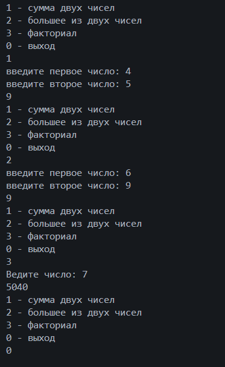
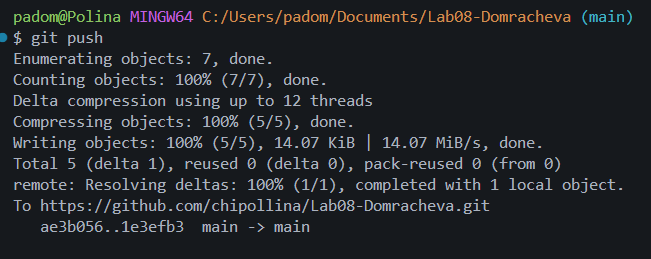

# Практическая работа №8 
**ФИО: Домрачевой Полины**   
**Группа: ИСП-241**   
**Дата:17.10.2026** 
## Что изучено 
- `void`-метод выполняет действие и ничего не возвращает, а метод с типом результата обязан вернуть значение через `return` на любом пути выполнения.
- Как передавать в метод разные данные — числа, строки и даже массивы — через параметры, и как забирать результат через `return`.
- Зачем нужны методы на практике: если один и тот же код повторяется, его лучше вынести в метод — тогда исправлять ошибку придётся один раз, а не в каждой копии.

